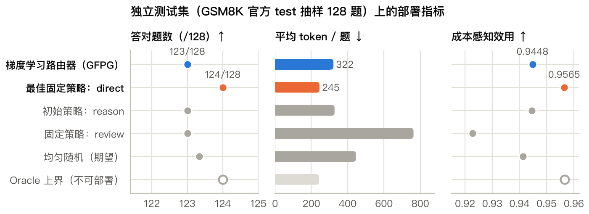
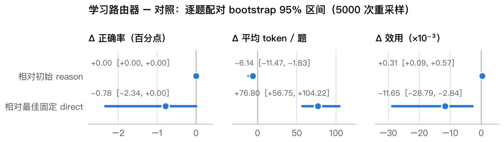
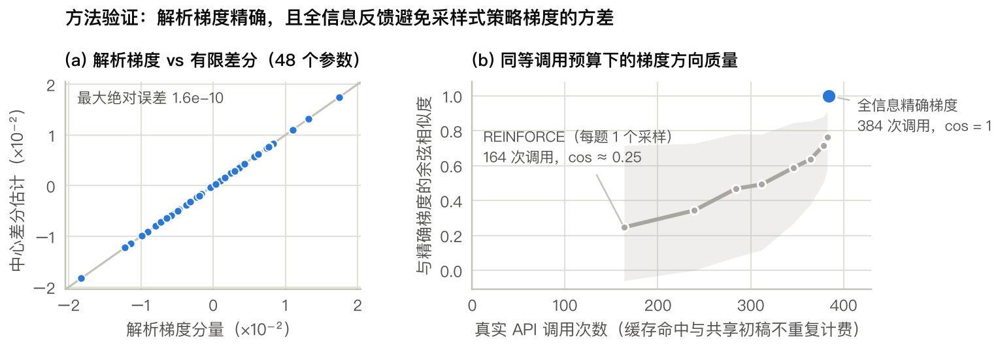
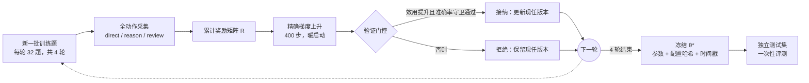
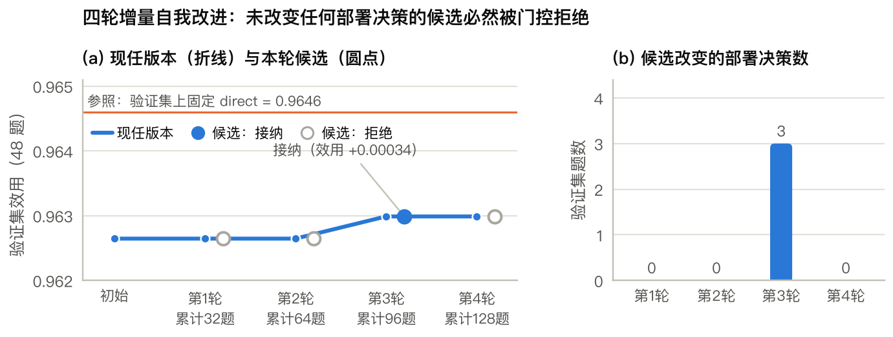

<div align="center">

# 门控全信息策略梯度（GFPG）

**面向 LLM Harness 受限自我改进的梯度类方法：设计、推导与真实 API 实验验证**

*Gated Full-information Policy Gradient for Budget-aware Self-Improvement of an LLM Harness*

**[课程报告 REPORT.pdf](REPORT.pdf)** · [实验测评报告](artifacts/gsm8k_flash_v1/REPORT.md) · [结果讨论](docs/findings.md) · [研究计划](docs/research_plan.md)

</div>

> **作业要求**：针对梯度类方法，AI 辅助下设计一个新的“梯度类”方法，并通过实验验证其有效性；可以是一个 RSI 相关的 Harness 工程。
>
> **本项目**：固定基础模型与提示词，只在 CPU 上训练一个 **48 参数**的 softmax 路由器，为每道数学题在 `direct` / `reason` / `review` 三条执行路线中选择其一；用“全动作实测”的奖励矩阵求期望效用的**精确解析梯度**，再通过“新批次反馈 → 梯度更新 → 验证门控 → 接纳或回退”的四轮循环完成可审计的增量自我改进，并在 GSM8K 上用 **938 次真实 API 请求**验证。

完整的方法推导、AI 辅助设计过程、全部图表与讨论见根目录 **[REPORT.pdf](REPORT.pdf)**。本仓库可直接打包提交：报告、代码、实验原始数据、离线复核脚本与测试都已包含在内。

## 作业要求与本项目的对应

| 作业要求 | 本项目的对应内容 | 详见 |
| --- | --- | --- |
| 针对梯度类方法 | 以期望效用为目标的 softmax 策略梯度上升；推导含熵正则的解析梯度，并用有限差分逐分量验证 | 报告 §3、§6.1 |
| 设计“新的”梯度类方法 | GFPG：全信息精确梯度 + 预算感知效用 + 验证门控增量自改进 + 测试前冻结协议 | 报告 §3 |
| AI 辅助下设计 | AI 编程助手参与问题筛选、梯度推导、实现、测试与报告；人负责目标、约束与审核 | 报告 §4 |
| 通过实验验证有效性 | 938 次真实 API 请求；独立测试集；逐题配对 bootstrap；强基线与 oracle 诊断；正负结果都报告 | 报告 §5–§7 |
| RSI 相关的 Harness 工程 | 四轮自我改进循环；预算账本、防重复计费缓存、测试前冻结、无需密钥的离线复核 | 报告 §3.5–§3.6 |

## 核心结果

在 128 道独立测试题（GSM8K 官方 test 抽样）上：

| 测试集指标 | 梯度学习路由器（GFPG） | 验证集选出的最佳固定策略（direct） | 初始策略（始终 reason） |
| --- | ---: | ---: | ---: |
| 答对题数 | 123/128 | **124/128** | 123/128 |
| 平均 token / 题 | 322.00（−1.87%） | **245.20（−25.28%）** | 328.14 |
| 成本感知效用 | 0.9448 | **0.9565** | 0.9445 |

- **相对初始 harness：有效，但幅度小。** 逐题正确性完全相同，每题 token 差 −6.14，95% 配对 bootstrap 区间 [−11.47, −1.83] 不含 0；效用差 +0.00031，区间 [+0.00009, +0.00057]。
- **相对最佳固定策略：显著更差。** 效用差 −0.01165，区间 [−0.02879, −0.00284]。实际部署更推荐固定 `direct`；冻结的梯度路由器作为完整、可复现的方法实验保留。
- **原因诊断**：使用测试标签的 oracle 也只答对 124/128，仅比固定 `direct` 再省 1.36% token——三条路线在该基准上几乎没有可供路由利用的互补空间；另有 3/4 轮候选“改变了概率却没有改变任何部署决策”而被门控拒绝（报告 §6.4、§7.2）。





## 方法：GFPG

### 三条冻结的执行路线

| 动作 | 行为 | 部署调用数 |
| --- | --- | ---: |
| `direct` | 请求只给出最终数值答案 `<answer>number</answer>` | 1 |
| `reason` | 请求简洁的分步计算，最后给出答案 | 1 |
| `review` | 先按 `reason` 生成初稿，再用第二次请求复核并修正 | 2 |

`review` 在采集时复用同题 `reason` 的初稿，因此每题采集成本为 3 次请求；但部署成本始终按两次调用计。`direct` 只约束可见输出，模型内部仍可能产生推理 token。

### 目标与精确梯度

路由器只读题面，提取 15 个特征（长度、数字个数、运算关键词等），共 $15\times 3+3=48$ 个参数：

$$
\pi_\theta(a\mid x_i)=\mathrm{softmax}(W^{\top}x_i+b)_a,\qquad
r_{ia}=\mathbf{1}[\text{答对}]-0.05\cdot\frac{\text{token}_{ia}}{1000}.
$$

在每题三条路线都实测过的奖励矩阵 $R$ 上，最大化含熵与 $L_2$ 正则的期望效用：

$$
J(W,b)=\frac{1}{N}\sum_{i=1}^{N}\Big[\sum_a \pi_{ia}r_{ia}+\tau H(\pi_i)\Big]-\frac{\lambda}{2}\lVert W\rVert_F^2,\qquad \tau=0.01,\ \lambda=0.03 .
$$

对 logit 的精确梯度（推导见报告 §3.3）为

$$
g_{ia}=\pi_{ia}\Big[r_{ia}-\bar r_i-\tau\big(\log\pi_{ia}+H(\pi_i)\big)\Big],\qquad
\nabla_W J=\frac{1}{N}\sum_i x_i g_i^{\top}-\lambda W,\qquad
\nabla_b J=\frac{1}{N}\sum_i g_i .
$$

与采样式 REINFORCE 不同，这里没有蒙特卡洛方差；与 TextGrad 的“文本梯度”不同，这是对实值参数的数值导数，可以用有限差分直接验证。部署与验证一律使用确定性的 `argmax`。



### 自我改进循环（RSI Harness）



门控条件：候选的验证效用须严格高于现任（裕量 $10^{-6}$），且验证准确率不低于“初始与现任中的较高者”减 0.03，防止多轮小幅退化累积。



## 快速开始

需要 Python 3.10+、NumPy 和系统 `curl`（Windows 自带的 `curl.exe` 即可）。以下命令在仓库根目录执行，macOS / Linux 与 Windows PowerShell 通用：

```bash
python -m pip install -r requirements.txt
python -m unittest discover -s tests -v                      # 36 项单元测试
python scripts/replay_report.py --run artifacts/gsm8k_flash_v1  # 离线复核全部实验数值
```

离线复核不读取密钥、不调用模型：它校验实现文件哈希、数据划分、逐题评分、逐请求 token 账、冻结策略、每轮门控、测试指标、配对 bootstrap 与预测导出，全部通过时输出 `"status": "verified_offline"`，并重建 [`REPORT.md`](artifacts/gsm8k_flash_v1/REPORT.md) 与 `summary.svg`。

重新生成报告图表与 PDF（可选）：

```bash
python -m pip install -r requirements-report.txt   # matplotlib
python scripts/make_figures.py                     # report/figures/* 与 report/generated/*.tex
cd report                                         # 以下需要 XeLaTeX + ctex
latexmk -xelatex main.tex
cp main.pdf ../REPORT.pdf
```

报告中的所有数值都由 `scripts/make_figures.py` 从实验产物自动生成到 `report/generated/`，没有手工抄写的结果。

## 重新运行真实实验（会产生 API 调用）

支持 OpenAI 兼容的 `/v1/chat/completions` 接口；本次实验使用 `deepseek-v4.1-flash`。先在本机设置环境变量，**不要把真实密钥写进 Git 文件**（`.secrets/` 与 `.env` 已被忽略）：

```bash
# macOS / Linux
export HARNESS_BASE_URL='https://your-provider.example/v1'
export HARNESS_MODEL='your-model-name'
export HARNESS_API_KEY='<your-local-key>'
python scripts/download_data.py
python -m harness_rsi.experiment --output artifacts/my_run --max-requests 980 --workers 4
```

```powershell
# Windows PowerShell
$env:HARNESS_BASE_URL = 'https://your-provider.example/v1'
$env:HARNESS_MODEL = 'your-model-name'
$env:HARNESS_API_KEY = '<your-local-key>'
python scripts/download_data.py
python -m harness_rsi.experiment --output artifacts/my_run --max-requests 980 --workers 4
```

也可通过 `--credentials .secrets/api.json` 读取本机配置。默认 128 训练题、48 验证题、128 测试题，共 304 题，无失败时需要 912 次请求；980 是包含失败重试的硬上限。中断后重复同一命令即可复用缓存与逐题结果：请求账本持久化，重启不会重置预算；同一输出目录只允许一个进程；参数、题库或实现不一致时会拒绝继续。

小规模试验：

```bash
python -m harness_rsi.experiment --output artifacts/pilot --train-size 40 --val-size 20 --test-size 40 --max-requests 350 --workers 4
```

### 用冻结策略回答新题

```bash
python scripts/solve.py --question "A box contains 12 pencils. How many pencils are in 7 boxes?" --run artifacts/gsm8k_flash_v1 --credentials .secrets/api.json
```

此命令会调用真实 API，模型与接口地址必须与冻结配置一致（也可沿用 `HARNESS_*` 环境变量）。输出 JSON 包含所选路线、回答及完整路线的 token 与调用数，`review` 始终累计两步成本。新推理使用 `artifacts/inference/gsm8k_flash_v1/` 下的独立缓存与账本，默认最多累计尝试 2 次请求；需要处理更多新题时用 `--max-requests 10` 等参数主动提高上限。

## 结果应如何解释

- 主要比较是“学习路由器 − 验证集选出的最佳固定策略”，并辅以初始 `reason`、三条固定路线、均匀随机路由的期望值；oracle 使用测试标签逐题选动作，只是不可部署的上界。
- 在独立测试题上分别报告正确率、token、调用数、延迟与成本感知效用，并按题配对 bootstrap 求 95% 区间。区间跨 0 时只写“证据不足”，不挑选对自己有利的基线。
- 局限：只有一个模型、一个公开基准子集和一个训练种子；128 道测试题中一题即 0.78 个百分点；GSM8K 是公开数据，不能排除预训练污染；同一验证集用于 4 次门控，存在自适应选择；token 不等于货币成本。
- 仓库中另存的 4000 步收敛检查（`artifacts/convergence_check/`）是在看到早期验证结果后追加的探索性分析，严格不替换原方案的结论，见其 `NOTE.md`。

## 项目结构

```text
REPORT.pdf                    课程报告（提交用）
README.md                     本文件
harness_rsi/
  client.py                   缓存、限速、预算账本、真实 token 记账
  tasks.py                    GSM8K 划分与精确数值评分
  strategies.py               三条冻结执行路线
  policy.py                   15 维特征、48 参数路由器与精确梯度
  experiment.py               四轮自我改进、验证门控、冻结后测试
  evaluation.py               指标与配对 bootstrap
  report.py                   中文测评报告与静态 SVG 图
scripts/
  replay_report.py            离线复核并重建测评报告
  make_figures.py             生成课程报告的图表与数值表
  download_data.py            下载并校验 GSM8K 官方数据
  solve.py                    用冻结策略回答新题
  convergence_check.py        探索性收敛检查
tests/                        单元测试：梯度、预算、缓存、评分、门控、报告
artifacts/gsm8k_flash_v1/     真实实验：配置、逐题观测、请求账本、各轮候选、冻结策略、测评报告
artifacts/convergence_check/  探索性 4000 步收敛检查（如实标注）
report/                       课程报告的 LaTeX 源码、图表与自动生成的数值表
docs/                         研究计划、结果讨论、来源核验记录
data/                         GSM8K 许可证与数据来源说明
```

## 文档索引

- [`REPORT.pdf`](REPORT.pdf)：课程报告（问题建模、方法推导、AI 辅助设计过程、实验结果、讨论与局限）。
- [`artifacts/gsm8k_flash_v1/REPORT.md`](artifacts/gsm8k_flash_v1/REPORT.md)：由 `summary.json` 自动生成的实验测评报告。
- [`docs/findings.md`](docs/findings.md)：实测结论与作业讨论。
- [`docs/research_plan.md`](docs/research_plan.md)：问题筛选、数学推导、实验设计与预先写定的解释规则。
- [`docs/source_verification.json`](docs/source_verification.json)：相关论文页面的核验记录；其中两条 GSM8K 条目是早期直连 GitHub 超时的日志，数据最终经镜像下载并逐行校验，见 [`data/SOURCE.md`](data/SOURCE.md)。原始数据目录 `data/raw/` 不随仓库分发，运行 `python scripts/download_data.py` 即可重新获取。

## 许可证

项目代码采用 [MIT 许可证](LICENSE)；GSM8K 数据保留其[原始许可证](data/GSM8K_LICENSE.txt)与[来源说明](data/SOURCE.md)。
