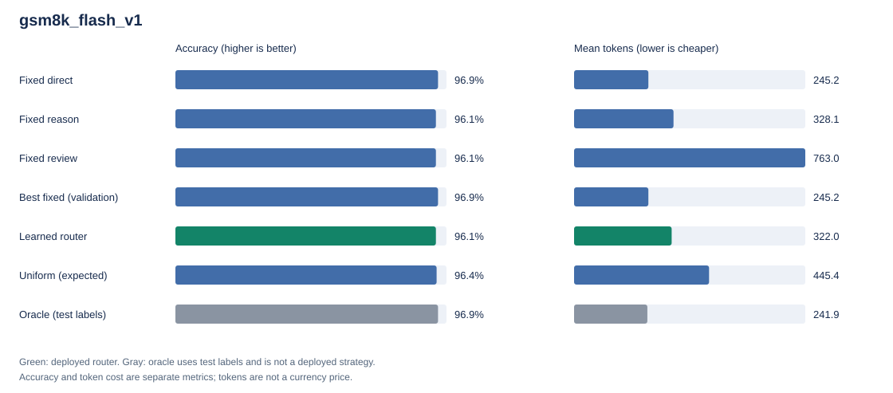

# gsm8k_flash_v1：实验测评报告

> 本文件由 `harness_rsi/report.py` 根据同目录的 `summary.json` 自动生成；运行 `python scripts/replay_report.py --run <运行目录>` 可在不调用模型、不读取密钥的情况下离线复核全部数值并重建本文件。

本实验固定基础模型与提示词，只在 CPU 上用梯度更新一个小型路由器，为每道题选择执行路线（direct / reason / review）。循环包括收集训练反馈、更新候选路由器、验证门控和接纳或回退。这是参数化 harness 的受限自我改进，不代表任意代码递归修改或通用能力持续增长。

## 关键数字

| 测试集指标 | 梯度学习路由器 | 最佳固定策略（direct） | 初始策略（reason） |
| --- | ---: | ---: | ---: |
| 正确题数 | 123/128 | 124/128 | 123/128 |
| 正确率 | 96.09% | 96.88% | 96.09% |
| 平均 token / 题 | 322.00 | 245.20 | 328.14 |
| token 相对初始策略 | -1.87% | -25.28% | 0.00% |
| 平均调用次数 | 1.00 | 1.00 | 1.00 |
| 成本感知效用 | 0.9448 | 0.9565 | 0.9445 |

## 主要结论

1. **相对初始 harness**：学习路由器与初始策略分别答对 **123/128** 与 **123/128**；平均 token 从 328.14 变为 322.00（**-1.87%**），效用配对比较结论为“显著更优”。
2. **相对最佳固定策略**：验证集事先选中的固定 `direct` 答对 **124/128**，平均仅用 245.20 token（相对初始策略 **-25.28%**），效用配对比较结论为“显著更差”。梯度方法的增益必须同时与这一简单基线比较，不能只比较初始策略。
3. **准确率**：学习路由器与最佳固定策略的准确率差区间包含 0；即使某一方多答对了题目，也不能据此声称准确率显著不同。准确率证据与 token / 效用证据应分别解释。
4. **路由空间诊断**：使用测试标签的 oracle 与最佳固定策略正确率相同，仅再节省 **3.3281 token/题（1.36%）**。这说明在本批题目、已采集的三条策略及当前效用权重下，精细路由超过固定选择的可用空间很小；oracle 不能部署，这一诊断也不能外推到其他模型或任务。

## 实验设置

- 数据集：`GSM8K (official train/test)`；模型：`deepseek-v4.1-flash`；温度：0。
- 训练 / 验证 / 测试题数：128 / 48 / 128；随机种子：42；请求尝试上限（含重试）：980。
- 优化：4 轮 × 每轮 400 步全批量梯度上升，学习率 0.2，熵系数 0.01，L2 系数 0.03；门控准确率容差 0.03。
- 效用定义：`accuracy - 0.05 × mean_tokens / 1000`。该权重表达预先设定的质量与成本偏好，改变权重会改变结论。
- 最佳固定策略由验证集选为 `direct`；最终冻结的路由器版本为 `3`（0 表示初始版本）。
- 路由器使用完整动作反馈的精确期望效用梯度；部署与验证执行确定性 argmax。均匀随机基线报告期望指标。

## 独立测试集结果

除 oracle 外，所有策略都在查看测试结果前冻结。Oracle 使用测试标签逐题选择最优动作，只表示已采集动作的效用上界，不能部署，也不能作为已取得的收益。

| 策略 | 答对 | 正确率 | 平均 token | 平均调用次数 | 平均延迟（秒） | 效用 |
| --- | ---: | ---: | ---: | ---: | ---: | ---: |
| **梯度学习路由器（GFPG）** | 123/128 | 96.09% | 322.0 | 1.00 | 1.637 | 0.9448 |
| 验证集选出的最佳固定策略（direct） | 124/128 | 96.88% | 245.2 | 1.00 | 1.097 | 0.9565 |
| 初始策略（始终 reason） | 123/128 | 96.09% | 328.1 | 1.00 | 1.613 | 0.9445 |
| 固定 direct（只给答案） | 124/128 | 96.88% | 245.2 | 1.00 | 1.097 | 0.9565 |
| 固定 reason（简短分步） | 123/128 | 96.09% | 328.1 | 1.00 | 1.613 | 0.9445 |
| 固定 review（分步 + 复核） | 123/128 | 96.09% | 763.0 | 2.00 | 3.261 | 0.9228 |
| 均匀随机路由（期望指标） | 123.33/128 | 96.35% | 445.4 | 1.33 | 1.990 | 0.9413 |
| 逐题最优 oracle（使用测试标签，不可部署） | 124/128 | 96.88% | 241.9 | 1.00 | 1.089 | 0.9567 |

## 收益证据（逐题配对 bootstrap）

相对验证集选出的最佳固定策略，效用差的 95% 配对 bootstrap 区间上界小于 0；当前路由器劣于最佳固定策略，不能宣称梯度路由优于简单固定选择。

差值均为“学习路由器 − 对照”，格式为“点估计 [95% 区间]”。准确率差以百分点表示；token 差为负表示节省。

| 对照 | Δ 正确率（百分点） | Δ 平均 token / 题 | Δ 效用 | 效用结论 |
| --- | ---: | ---: | ---: | --- |
| 相对初始策略 | 0.00 [0.00, 0.00] | -6.14 [-11.47, -1.83] | +0.00031 [+0.00009, +0.00057] | 显著更优 |
| 相对最佳固定策略 | -0.78 [-2.34, 0.00] | +76.80 [+56.75, +104.22] | -0.01165 [-0.02879, -0.00284] | 显著更差 |

区间按题配对重采样，反映该批测试题的采样不确定性；不包含模型采样方差、数据污染风险或重复挑选测试结果的偏差。小样本区间包含 0 时，应报告证据不足，不能把点估计提升写成确定结论。效用提升也不等于准确率提升。

## 自我改进循环

每轮：新一批训练题 → 采集全部动作 → 在累计奖励矩阵上做精确梯度上升（暖启动）→ 验证门控 → 接纳或保留现任版本。

| 轮次 | 累计训练题 | 训练目标 J（起点 → 终点） | 现任验证效用 | 候选验证效用 | 门控 | 说明 |
| ---: | ---: | --- | ---: | ---: | --- | --- |
| 1 | 32 | 0.95773 → 0.95924 | 0.96264 | 0.96264 | 拒绝 | 验证门控拒绝候选，保留现任版本 |
| 2 | 64 | 0.95693 → 0.95858 | 0.96264 | 0.96264 | 拒绝 | 验证门控拒绝候选，保留现任版本 |
| 3 | 96 | 0.95069 → 0.95491 | 0.96264 | 0.96299 | **接纳** | 验证效用提升且准确率守卫通过，接纳候选 |
| 4 | 128 | 0.94855 → 0.94923 | 0.96299 | 0.96299 | 拒绝 | 验证门控拒绝候选，保留现任版本 |

最终测试路由分布：direct=7，reason=121，review=0。

复核（review）相对其初稿：纠正 0 题，将原本正确的答案改错 0 题。复核并不保证改善，因此同时记录纠错与改错。

测试集上未给出有效数值答案的题数：direct=0，reason=1，review=1。这些题按答错计分，并保留其 token 成本。

验证集上的候选比较是选择依据，不能作为最终泛化收益。若所有候选均未被接受，保留初始版本也是有效实验结果。

## 收集成本与部署摊销

| 请求尝试（含失败重试） | 成功 | 失败 | 输入 token | 输出 token | 合计 token |
| ---: | ---: | ---: | ---: | ---: | ---: |
| 938 | 912 | 26 | 156018 | 159799 | 315817 |

token 不等同于人民币或美元。不同模型输入、输出、缓存 token 计价可能不同；未给定单价时不报告货币收益。失败请求可能仍产生供应商费用，缺失 usage 的费用也无法从该日志完整还原。

本测试的准确率差区间未显示下降。在未来质量保持、成本与题目分布稳定的条件下，每题平均节省 6.14 token，条件摊销门槛为约 **51,431 道后续题目**：`ceil(315817 / 6.140625)`。这里把整个收集过程（含评测）的已记录 token 都计入前期成本，属于保守的探索成本核算；该数字是有条件估算，不是已经获得的净收益。

## 解释边界

- 本实验只更新小型路由器，不训练基础语言模型，也不需要 GPU。
- 完整动作反馈会产生额外探索开销；缓存和重复梯度更新不等于免费的新模型反馈。
- 测试标签只用于最终评测及标注为 oracle 的上界，不得用于选择轮次、特征或成本权重。
- 同一验证集多轮选择可能过拟合；报告的是最终冻结版本在独立测试集上的表现。
- 延迟受网络、并发及缓存影响，单次观测不能证明稳定的生产延迟收益。
- 若数据集标识为 synthetic/demo/fixture，相应结果只证明工程链路可运行，不能替代真实模型 benchmark。
